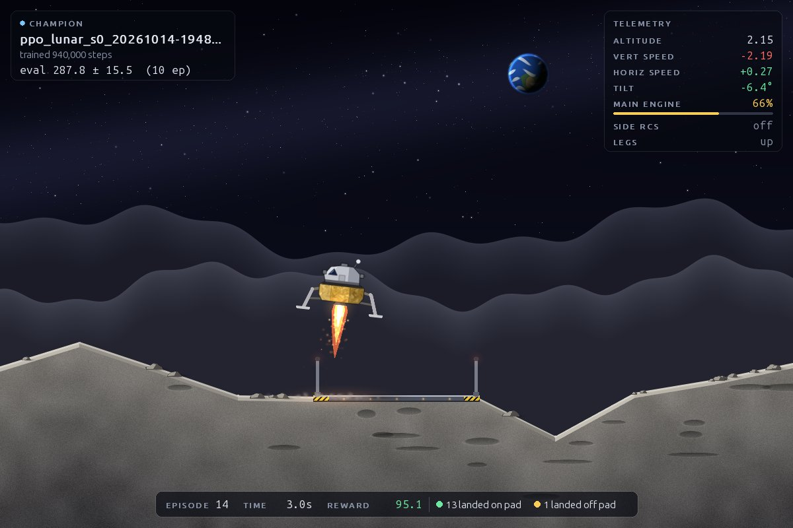

# rl-lander

Autonomous powered-descent landing, learned (RL) vs. optimization-based guidance.

**Phase 1 (this repo state):** the infrastructure. PPO agents train headless on
Gymnasium's `LunarLander-v3` (continuous actions), several runs at once. A separate
viewer window continuously flies the best model found so far and swaps in better
ones as training produces them. Later phases plug a custom 3DOF powered-descent env
into the same training/eval/viewer code. **Next:** a 3D point-mass lunar descent env
posed as the G-FOLD problem; see the [Phase 2 plan](docs/phase2-plan.md).



```
configs/ppo_lunar.yaml      run config: env, seed, PPO hyperparameters (annotated)
src/lander/envs/            env registry: config name -> constructor, outcome classifier, scene
src/lander/envs/lunar_lander_scene.py   the viewer's LunarLander renderer (lander, terrain, effects)
src/lander/envs/descent3d.py            Phase 2: 3D point-mass lunar powered descent (G-FOLD problem)
src/lander/envs/descent3d_scene3d.py    its 3D viewer scene (default): OpenGL, cameras, effects
src/lander/envs/descent3d_scene.py      its 2D viewer scene: zooming side view + top-down inset
src/lander/viz3d/                       3D rendering: moderngl renderer, KSP .mu/.cfg readers, terrain
src/lander/assets/apollo_lm/            the Apollo LM model (from Bluedog Design Bureau, CC BY-NC-SA 4.0)
src/lander/assets/terrain_apollo11/     real Apollo 11 site imagery (NASA LROC, public domain)
src/lander/envs/scene_art.py            art shared by the scenes (sky, Earth, lander sprite, glows)
src/lander/controllers/     non-learned controllers with the policy API (ZEM/ZEV guidance; G-FOLD next)
tests/                      pytest suite (`make test`)
src/lander/train.py         one headless training run          (lander-train)
src/lander/launch.py        N runs as parallel processes        (lander-launch)
src/lander/champion.py      per-run best + global champion
src/lander/checkpoints.py   save/load policies (+ observation-normalisation stats)
src/lander/evaluate.py      fixed-seed evaluation with success rates and CIs (lander-eval)
src/lander/viewer.py        live viewer, hot-reloads champion   (lander-viewer)
src/lander/hud.py           viewer overlay: model card, telemetry, banners (env-agnostic)
src/lander/sound.py         procedural sound effects for the viewer
Makefile                    shortcuts: `make help`
runs/                       outputs (gitignored)
```

## Setup

Developed and tested on **WSL2 (Ubuntu 24.04) on Windows 11**. The viewer window
appears on the Windows desktop through WSLg, with no X server to configure.

Dependencies are pinned in `pyproject.toml` and locked in `uv.lock`. Python 3.11.

```bash
# once: install uv (https://docs.astral.sh/uv/)
curl -LsSf https://astral.sh/uv/install.sh | sh
# in the repo: creates .venv with Python 3.11 and the exact locked versions
uv sync
```

Notes on the usual pain points:

- **Box2D/swig:** not needed anymore. Gymnasium ≥ 1.4 depends on the `box2d` package,
  which ships prebuilt wheels (Linux and Windows), instead of `box2d-py`, which had
  to be compiled with swig. If an older guide tells you to install swig, ignore it.
- **PyTorch** comes from the CPU-only index (see `[tool.uv.sources]` in
  `pyproject.toml`), which is ~200 MB instead of ~3 GB of CUDA libraries. A 64x64 MLP
  trains no faster on a GPU, since data transfer dominates.

**Native Windows (untested):** the lock file includes win_amd64 wheels for every
dependency, so this should work without a compiler. Use PowerShell:

```powershell
powershell -ExecutionPolicy ByPass -c "irm https://astral.sh/uv/install.ps1 | iex"
uv sync            # uv downloads Python 3.11 itself; your system Python 3.14 is not used
uv run lander-viewer
```

## Usage

The quickest route is the Makefile. Run `make help` to list targets; override variables
inline, e.g. `make launch SEEDS="0 1"` or `make replay MODEL=runs/<run>/best/step_000420000.zip`.

```bash
make setup         # uv sync
make launch        # 4 seeds in parallel (SEEDS="0 1 2 3")
make viewer        # in a second terminal
make tensorboard   # in a third
```

The underlying commands, run from the repo root (prefix with `uv run`, or activate
`.venv` first):

```bash
# One run (~3 min for 1M steps)
uv run lander-train configs/ppo_lunar.yaml --seed 0
uv run lander-train configs/ppo_lunar.yaml --total-timesteps 5e4   # ~15 s smoke test (PPO rounds up to whole 16k-step rollouts)

# Several runs in parallel: every config x every seed, one process each
uv run lander-launch configs/ppo_lunar.yaml --seeds 0 1 2 3

# Viewer (separate terminal). Start it before, during or after training.
uv run lander-viewer
uv run lander-viewer --model runs/<run>/best/step_000420000.zip   # replay one checkpoint
uv run lander-viewer --fps 150 --scale 0.8                        # 3x speed, smaller window
uv run lander-viewer --runs-dir runs/descent3d                    # the Phase 2 env (see below)
uv run lander-viewer --plain                                      # the env's own basic rendering
uv run lander-viewer --mute                                       # start silent (M toggles sound)

# Evaluate on 200 fixed seeds: the champion, or any checkpoints side by side
uv run lander-eval
uv run lander-eval runs/a/best/step_X.zip runs/b/best/step_Y.zip --episodes 500 --out results.json

# TensorBoard: one curve per run; open http://localhost:6006 in your Windows browser
uv run tensorboard --logdir runs
```

To compare hyperparameters, copy the config, edit it, and pass both files to
`lander-launch`. Run names are `<config-file>_s<seed>_<timestamp>`.

The champion is global to a runs directory, including runs from earlier
sessions. For a fresh competition (or a different env, whose rewards aren't
comparable), use another directory: `--runs-dir runs/exp2` on both launcher and viewer.

### What the viewer shows

- **Scene:** a custom renderer draws the lander, terrain and landing pad from the
  live physics state, so the picture is exactly what the policy experiences.
  - The legs move on their sprung joints, and the pad beacons blink red, turning
    green after a landing on the pad.
  - The main-engine plume scales with throttle, the side RCS jets fire on the side
    actually firing, and engine dust sprays off the ground near the surface.
  - A crash ends in an explosion and a scorched wreck.
- **Model card** (top left): the run, training step and eval score (mean ± std over
  the eval episodes). When a better champion appears mid-episode, the card says so,
  and a toast confirms the swap after the episode ends.
- **Telemetry** (top right): altitude, vertical/horizontal speed and tilt, coloured
  green, amber or red near the ground; main-engine throttle, side-thruster state and
  leg contact. Values are in the simulator's world units.
- **Episode strip** (bottom): episode number, sim time, running reward, and a tally
  of outcomes so far.
- **Outcome banner** after each episode: `TOUCHDOWN` (on or off the pad), `CRASH`,
  `LOST` (flew off-screen) or `TIMEOUT` (still hovering after 1000 steps).
- **Sound:** an engine rumble that follows the throttle, a hiss from the side
  thrusters, a touchdown thud (with a chime for an on-pad landing), an explosion on a
  crash, a falling tone when the lander is lost, and a chime when a new champion
  loads. Sounds are panned to the lander's position. Press `M` to toggle;
  `--mute` starts silent, and `--volume 0..1` sets the level. Everything is
  synthesised with numpy at startup (`src/lander/sound.py`), so there are no audio
  files. Without an audio device the viewer just runs silent. Under WSL2, sound goes
  to Windows through WSLg automatically.

The window is resizable and the picture scales to fit. Close it or press `q`/`Esc`
to quit. The console also logs each load and each episode's outcome.

### Evaluating

`lander-eval` is the measuring stick; the eval score in `champion.json` and the viewer
are not. Episode *i* always starts from seed `--seed + i`, so every model sees exactly
the same start conditions and comparisons are paired. It reports:

- **success rate** with a 95% confidence interval (a Wilson interval, which stays sensible
  near 0% and 100%). "Success" is the env's definition of mission success: for
  LunarLander that's `landed on pad`, not a reward threshold;
- the count of every outcome, and mean return with a 95% confidence interval;
- **landing metrics on the successful episodes**: distance from the pad centre,
  touchdown speed (at first leg contact), tilt, engine use (a fuel proxy) and duration.

`--out file.json` also saves every episode, for your own analysis. 200 episodes take
about 10 s.

### Observation normalisation

Set `normalize: true` in a config (or `normalize: {obs: true, reward: true}`) to wrap
training in SB3's `VecNormalize`. It rescales every observation by a running estimate of
its mean and standard deviation, so inputs with very different physical scales reach the
network at a similar size. The network then only understands normalised inputs, so the
statistics are part of the policy: they're saved beside every checkpoint as
`step_*.vecnormalize.pkl`, and the viewer and `lander-eval` load them automatically.
LunarLander's observations are already roughly unit-scale, so the provided config leaves
normalisation off. Phase 2's physical-unit env needs it. (In a test, one seed with it
on solved LunarLander at 170k steps instead of 300k.)

### Outputs

```
runs/champion.json                 global best: run, model path, step, mean/std, env, timestamp
runs/<run>/config.yaml             the exact config used (incl. seed)
runs/<run>/train.log               stdout (when started by lander-launch)
runs/<run>/best.json               this run's best (same format as champion.json)
runs/<run>/best/step_*.zip         every time the run improved: an immutable checkpoint
runs/<run>/best/step_*.vecnormalize.pkl   its normalisation stats (only with `normalize`)
runs/<run>/final_model.zip         the model at the end (or at Ctrl+C)
runs/<run>/evaluations.npz         all eval results (SB3 EvalCallback format)
runs/<run>/tb/                     TensorBoard events
```

## What to expect

Measured on this machine (20-core CPU) with the provided config, 4 seeds launched
together:

- **Reliability of the final champion** (`lander-eval`, 200 fixed seeds): 200/200 on the
  pad (95% CI 98-100%), touchdown at about 1 world unit/s, about 0.4 from the pad centre.
- **Speed:** ~6,000 env steps/s per run, so 1M steps takes **~3 min**. 4 parallel
  runs finished in 168-176 s each, so they barely slow each other down (one torch
  thread each).
- **Learning curve:** mean eval reward is negative (crashing) until ~100-150k steps.
  First landings come around 150-200k. The runs were **solved (≥ 200) at 250k, 300k,
  330k and 460k steps** for seeds 1, 0, 3 and 2. By 1M steps the best eval means
  were 267-288.
- **"Solved" is not "reliable".** Two checkpoints, each re-evaluated on 100 fresh
  episodes:

  | checkpoint | eval score when selected | 100-episode mean | on pad | off pad | crashed / off-screen |
  |---|---|---|---|---|---|
  | seed 1 @ 250k (first "solved") | 234.5 | 135.7 ± 152 | 34 | 33 | 33 |
  | seed 0 @ 940k (final champion) | 287.8 | 274.2 ± 21 | **100** | 0 | 0 |

  The first "solved" checkpoint crashes a third of the time. After ~1M steps the
  champion lands on the pad every time. Both checkpoints score lower on fresh
  episodes than when they were selected (see *winner's curse* below).

## RL notes (why things are the way they are)

**Reward scale.** LunarLander gives a shaped reward every step: points for moving
toward the pad, slowing down and staying upright; +10 per leg touching down; a
small cost per frame of engine use. On top of that comes a terminal +100 for coming
to rest or -100 for crashing. A clean landing totals roughly 200-300. Random flying
scores about -200.

**What "solved" means.** Gymnasium's bar for this env is an average return of
**200**. That is a statement about reward, not about pad accuracy. The +100 rest bonus
is paid wherever the lander comes to rest. The distance-to-pad term in the shaping is
mild, so a soft touchdown just outside the flags can still score 200+. The viewer
therefore reports *on pad* vs *off pad* separately. For Phase 2: reward ≠ mission
success, so measure the outcome you actually care about (touchdown position error,
velocity, tilt) directly.

**Why PPO.** It's the standard robust baseline for continuous control. It learns
from fresh batches of experience and clips each update, so one bad batch can't
wreck the policy. That makes it forgiving of hyperparameters, and it parallelises
across envs trivially. Off-policy methods (SAC, TD3) are more sample-efficient,
which matters when env steps are expensive. They aren't here. The hyperparameters
are the tuned set from [rl-baselines3-zoo](https://github.com/DLR-RM/rl-baselines3-zoo)
and are explained inline in `configs/ppo_lunar.yaml`.

**Why "best" = deterministic eval, not training reward.** During training the policy
samples actions from a Gaussian (exploration noise), and the policy changes while
the episodes are being collected. Training-episode returns therefore measure a
noisy, moving target. Every 10k steps, `EvalCallback` instead runs 10 fresh
episodes with the policy's *mean* action (deterministic). The checkpoint with the
highest mean of those is the run's best.

If the env reports mission success (`info["is_success"]`, as `descent3d` does),
checkpoints are ranked by **eval success rate first** and mean return only as a
tie-break, both for each run's best and for the global champion. On `descent3d` the
mean return correlated only about 0.2 with success, because the shaping depends
heavily on the start condition, so ranking by return alone picked checkpoints almost
at random. `champion.json`, `best.json`, the launcher's status table and the viewer's
model card all show the success rate when it's available.

**The winner's curse.** The mean of 10 episodes is still noisy (std is often
50-150, so the mean is uncertain by ±20-50). Picking the maximum over ~100
evaluations favours checkpoints that got lucky, so the champion's displayed score is
optimistic. Expect it to do somewhat worse over many episodes in the viewer. More eval
episodes (`eval.n_episodes`) shrink this effect at the cost of eval time.

**Why `vec_env: dummy`.** `n_envs: 16` envs are stepped in lockstep and their
experience is batched. For an env this cheap, stepping all 16 in one process
(`DummyVecEnv`) beat one process per env (`SubprocVecEnv`). Inter-process
communication cost more than the parallelism saved: 28 s vs 32 s for 200k steps.
Switch to `subproc` if a future env has an expensive `step()`.

## Design notes

- **Atomic files.** Every write goes to a temp file in the same directory, then
  `os.replace`s it into place. Checkpoints are never overwritten (each new best gets
  a new `step_*.zip`), so `champion.json` is the only file ever replaced. The viewer
  can't read a half-written file.
- **Champion races.** Runs finishing an eval at the same time update
  `champion.json` under a file lock (`filelock`), so the read-compare-write can't
  interleave.
- **Viewer reloads between episodes only.** It polls `champion.json` every 2 s. A
  failed load is retried, and the previous model keeps flying meanwhile.
- **The viewer draws into its own window** instead of using the env's
  `render_mode="human"`. Each env can register a *scene* (`EnvSpec.scene`) that draws
  from its physics state. Envs without one fall back to their own `rgb_array` frames.
  The HUD on top is env-agnostic; scenes feed it telemetry as a list of `Gauge`s.
  The scene is purely visual and never affects the simulation.
- **Adding an env (Phase 2):** write `src/lander/envs/<name>.py` with
  `make(render_mode=None, **kwargs)` and `outcome(env, terminated, truncated)`, add
  an `EnvSpec` to `REGISTRY` in `src/lander/envs/__init__.py`, and set `env.name` in
  a config. Training, eval, champion tracking and the viewer need no changes. A
  custom scene is optional: copy the method set of `LunarScene` (`reset`, `update`,
  `on_outcome`, `draw`, `gauges`, `banner`, `outcome_tone`, and for sound
  `sound_levels`, `outcome_sound`).

## Phase 2: 3D powered descent (in progress)

`descent3d` is the env Phase 2 is built around: the terminal phase of a lunar landing,
posed exactly as the G-FOLD problem. The design and the reasoning behind it are in
[docs/phase2-plan.md](docs/phase2-plan.md).

- **Model:** a point mass with Moon gravity. Thrust is 4.5-27 kN, and the engine can't
  shut off. The vehicle starts at 8 t with 600 kg of usable propellant, and burns it at
  `|T|/(Isp g0)` with Isp = 311 s.
- **Constraints:** thrust may tilt at most 45° from vertical, and the vehicle must stay
  above a 15° glide-slope cone rising from the edge of the 10 m landing zone.
- **Control and physics:** a new thrust command at 5 Hz, integrated with RK4 at 0.05 s.
- **Episode:** each starts 1-2 km up and up to 1 km away from the target, descending at
  15-40 m/s with up to 30 m/s of sideways drift.
- **Outcomes:**
  - `landed on target` (success): touchdown within 10 m, at ≤ 2 m/s vertical and
    ≤ 1 m/s horizontal speed
  - `landed off target`
  - `crashed`
  - `glide-slope violation`
  - `out of propellant`
  - `timeout`
- **Actions** are mapped into the thrust limits, so those can never be violated; only the
  glide slope can be.
- **Reward:** potential-based shaping (proven not to change which policy is optimal),
  a per-kg propellant cost, and ±100 at the end.
- **Configurable:** every parameter is a field of `DescentConfig` and can be overridden
  from a run config's `env.kwargs`.

**Reference controller:** `controllers/zem.py` implements classic ZEM/ZEV guidance, a
closed-form energy-optimal feedback law. It's the proof that the env is solvable:

```bash
uv run lander-eval --env descent3d --controller zem
```

On 200 seeds it lands 200/200 on target, with position error under 0.05 m and 352 kg of
propellant on average. Because it's energy-optimal rather than fuel-optimal, G-FOLD
should beat it on propellant.

**First PPO run** (`configs/ppo_descent3d.yaml`, untuned, 1M steps): 0% success. The
policy found a local optimum: it dives, and every episode ends in a glide-slope
violation about 30 s in, after burning about 50 kg. The shaping pays out the same
whatever the ending, so diving costs only the −100 terminal reward and saves propellant.
A real landing pays more, but exploration never finds one, because the cone ends
exploratory episodes early. Fixing the training signal is Milestone 4; see the plan.

**Watching it:** `make viewer RUNS=runs/descent3d` (or `uv run lander-viewer --runs-dir
runs/descent3d`). Keep descent3d runs in their own runs dir: the viewer follows one
champion per directory, and rewards from different envs aren't comparable.

The viewer is **3D** by default:
- **The lander** flies over the **real Apollo 11 landing site** in Mare Tranquillitatis
  (see below), under the sun that lit it in the source images (17° up, in the west),
  with real shadows, starfield and the Earth where it really stands from there (about
  66° up, in the west).
- **The model** is an Apollo LM, tilted to its thrust vector, with an exhaust plume, sparks
  and dust that flies off in lunar-gravity arcs near the surface.
- **Crashes** end in an explosion and a scorched, tipped-over wreck.
- **Overlays:** the 3D trajectory and its ground track, the landing zone with beacons, a
  red ring marking the glide-slope limit at the lander's current altitude (it must stay
  inside), and the glide-slope cone near the ground.
- **The HUD and top-down inset** are the same as in 2D.
- **Cameras:** press `C` to cycle between **chase** (behind the lander along its
  approach), **side**, **ground** (standing at the landing zone on the sun side, with a
  zoom lens) and **orbit**.

**Comparing PPO with ZEM/ZEV.** These targets fly the same seeded episodes
(`VIEW_SEED`, default 1000), so the two controllers face identical start conditions:
```bash
make viewer-ppo       # the descent3d PPO champion (RUNS3D=runs/descent3d)
make viewer-zem       # the ZEM/ZEV guidance law (viewer-zev is an alias: it's one law)
make viewer-compare   # both at once, in two windows side by side (sound from PPO only)
```
Two useful variables: `FPS=150` plays at 3x speed, and `COMPARE_SCALE=1.0` makes the
compare windows larger. Underneath it's `lander-viewer --env descent3d --controller zem
--seed 1000`.

**Apollo LM model from Bluedog Design Bureau.** The LM is bundled in
`src/lander/assets/apollo_lm/`: 1.5 MB of merged meshes and 1024px textures. It was
imported from the KSP mod Bluedog Design Bureau with `make import-assets
BDB=".../GameData/Bluedog_DB"`, which reads the LM parts from a KSP install:
- **Parts:** the ascent stage, descent stage, four landing legs posed at the end of
  their deploy animation, and the descent engine.
- **Assembly:** stacked at their KSP attach nodes, the default variants chosen, and scaled
  1.6x to real size.

It uses an independent reader for KSP's `.mu` model format (`src/lander/viz3d/mu.py`;
taniwha's io_object_mu documented the layout). `--bdb PATH` (or `LANDER_BDB`) makes the
viewer re-import live instead. If the bundle is missing, a simple built-in LM is used.

**License of the bundled model:** it's derived from Bluedog Design Bureau, © the BDB
team (CobaltWolf et al.), licensed
[CC BY-NC-SA 4.0](https://creativecommons.org/licenses/by-nc-sa/4.0/). That license
applies to `src/lander/assets/apollo_lm/` only (see its `ATTRIBUTION.md`): those files
are attribution-required, non-commercial, and share-alike. The rest of the repo isn't
affected, but don't use the bundled model commercially.

**Real terrain: Tranquility Base.** The ground is NASA Lunar Reconnaissance Orbiter
imagery of the Apollo 11 site, bundled in `src/lander/assets/terrain_apollo11/` (3.5 MB):
- **Imagery:** an LROC Narrow Angle Camera orthophoto at **0.5 m/px** within 512 m of the
  target and 2 m/px over a 4.2 km x 5.2 km area. Beyond that it's tiled, cross-faded so
  no seams show.
- **Landing target:** 25 m south of the real Apollo 11 descent stage, which you can see
  in the photo (the bright speck with a long shadow). The viewer labels it when the
  camera is within 600 m. Little West crater is just east of it.
- **Sun:** estimated by fitting the 2 m stereo terrain model's slopes to the photo's
  brightness (a 0.71 correlation), so the 3D lander's lighting and shadow match the
  baked-in shading. The physics ground stays the flat plane z = 0, so the real relief
  lives only in the imagery.
- **Re-importing:** `make import-terrain` re-creates the bundle. It range-downloads only
  the needed rows of the PDS products NAC_DTM_APOLLO11 and
  NAC_DTM_APOLLO11_M150361817_50CM (about 200 MB, cached in `~/.cache/lander/lroc`).
- **Credit:** NASA/GSFC/Arizona State University. NASA imagery is public domain.
- `--terrain procedural` (or `LANDER_TERRAIN=procedural`) switches back to the
  procedural craters.

**Rendering:** moderngl draws offscreen, and the pygame HUD goes on top.
- **Under WSL2** the viewer selects Mesa's d3d12 driver, so it runs on the Windows GPU
  (RTX 3070 here: about 6 ms per frame including the HUD).
- **Without GPU access** Mesa's software renderer still manages about 18 ms per frame.
- **Without OpenGL at all** the viewer falls back to the 2D scene; `--scene 2d` picks it
  explicitly.

**The 2D scene** (`--scene 2d`, or automatic without OpenGL):
- **Side view:** looks along the approach direction. The camera follows the lander
  and zooms in as it descends, from about 2.5 km wide at the start to tens of metres
  at touchdown. The lander is drawn tilted to its thrust direction, with a plume that
  scales with throttle.
- **Glide slope:** the cone is drawn as shaded no-go wedges, and a distance ruler
  along the ground adapts to the zoom.
- **Top-down inset:** the 10 m landing zone, the horizontal track, a velocity arrow,
  and a red ring showing the exact 3D glide-slope limit at the current altitude. The
  lander must stay inside the ring, which only appears once it's small enough to fit.
- **Telemetry:** altitude, vertical and horizontal speed, distance to target, thrust,
  tilt, propellant and glide-slope margin.
- **Playback:** the env decides at 5 Hz and the scene interpolates 10 frames per
  decision, so playback is smooth and real time by default; `--fps 150` is 3x.

**Getting PPO to land** took three changes, all options in `DescentConfig` / the
run config:
1. **Glide-slope penalty in training.** Below the cone costs reward instead of ending
   the episode. It still never counts as success, so success rates are unaffected.
2. **Graded touchdown reward.** A near miss earns partial credit that shrinks with how
   badly it missed, so the agent has a gradient towards the narrow success window.
3. **Start-condition curriculum.** Training starts low, close and slow, and widens to
   the full start box over the first 60% of training (`curriculum:` in the config;
   evaluation always uses the full box).

With all three, 4/4 seeds produced checkpoints at 77-94% success over 100 fixed seeds,
with soft, accurate touchdowns. **Known issue:** those policies are fuel-hungry. They
use 540-590 kg against ZEM/ZEV's 352, almost every failure is running out of
propellant, and by 3M steps every seed had drifted into running dry on 100% of
episodes. Watching it and measuring where the time goes shows why. Averaged over
100 fixed seeds:

| | above 100 m | 100 m to 20 m | last 20 m | total |
|---|---|---|---|---|
| PPO champion | 62 s, 355 kg | 25 s, 110 kg | 15 s, 63 kg | 102 s, 528 kg |
| ZEM/ZEV | 52 s, 266 kg | 7 s, 51 kg | 5 s, 37 kg | 64 s, 355 kg |

The policy creeps down the last 100 m (40 s against ZEM's 12), and every second near
hover costs about 4.5 kg. Ranking checkpoints by success rate (now the default) fixed the selection
problem: saved bests reach 98-100% success. Raising the propellant price on its own
didn't help (at 0.5 per kg the agent prefers to crash). See the plan for the next
iteration.

**Tests:** `make test` checks the physics against closed forms:
- free fall
- hover
- mass flow rate
- touchdown interpolated to the exact moment of contact

It also checks that actions never leave the feasible thrust set, that touchdown and
failure outcomes are classified correctly, that the shaping telescopes, that the env
passes Gymnasium's `check_env`, and that the ZEM controller lands.
